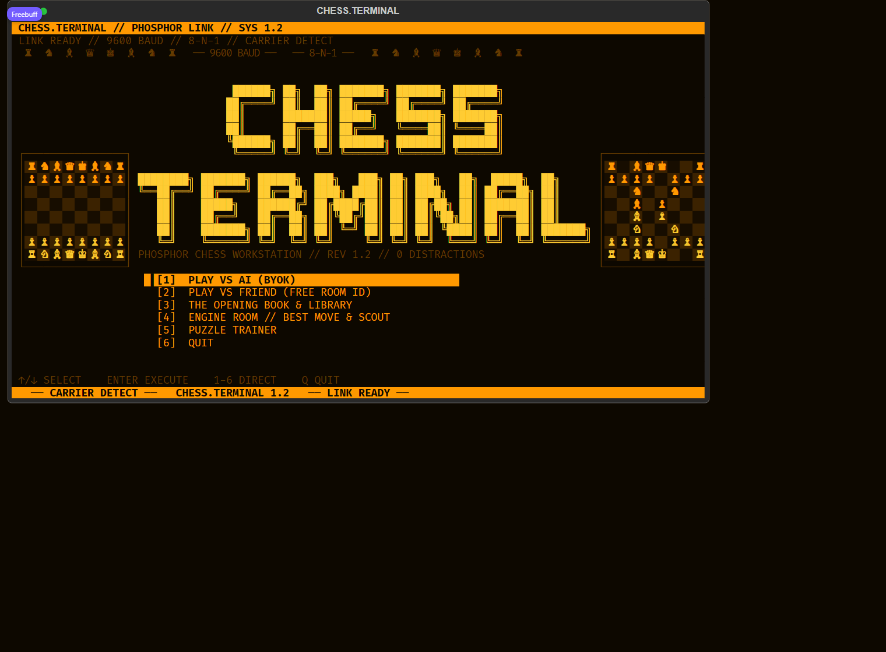

# Chess.Terminal

**A complete chess workstation that runs entirely in your terminal.** Amber
phosphor CRT visuals, a Stockfish analyser with game review, BYOK AI opponents,
free room-based friend games, a puzzle trainer and a 68-entry opening library —
no account, no telemetry, no key written to disk.

Built with [Textual](https://textual.textualize.io/) and
[python-chess](https://python-chess.readthedocs.io/).



<p align="center">
  
  
  
  
</p>

> **Actively developed.** This is a living project and updates land often —
> new screens, sharper analysis and fixes. Watch or star the repo to catch them,
> and see [all repositories](https://github.com/Belal-ElKhayat?tab=repositories)
> for everything else.

---

## Why it exists

A chess app for people who live in a terminal: the whole workstation is one
window, keyboard only, in a single amber palette. Study an opening, review last
night's game, drill tactics, play a friend over a WebSocket, and let an AI of
your choosing take the other side.

```text
[1] PLAY VS AI (BYOK)          [4] ENGINE ROOM // BEST MOVE & SCOUT
[2] PLAY VS FRIEND (FREE)      [5] PUZZLE TRAINER
[3] OPENING BOOK & LIBRARY     [6] QUIT
```

## What's inside

| Feature | What you get |
| --- | --- |
| **Best-move analyser** | Free board, Stockfish (or BYOK AI fallback), 3 lines, `P` plays the engine's move |
| **Game review** | Stockfish scores every move: blunders, mistakes, inaccuracies, brilliants, per-side accuracy |
| **Opening scout** | chess.com / lichess public games → your record, your openings, 3 recommended lines |
| **Play vs AI** | OpenAI, Anthropic, Gemini, OpenRouter or local Ollama; reply validated, retried with feedback |
| **Play vs friend** | Free relay, one room ID, optional tunnel, relay-authoritative clocks |
| **Opening book** | 33 openings, 12 traps (by colour), 15 famous games, 8 reference cards |
| **Puzzle trainer** | 24 mate-in-2/3 and winning-shot puzzles mined from the validated library |
| **Clocks** | 5\|0 and 10\|5, flags, increments, both sides agree |
| **Coach & saves** | Optional BYOK post-game coach, autosave/resume, PGN export everywhere |

## Install

Requires **Python 3.10+** and a terminal with Unicode box drawing (Windows
Terminal, iTerm2, kitty, Alacritty…).

```bash
git clone https://github.com/Belal-ElKhayat/Chess.git
cd Chess
pip install -e .
```

Two commands appear on your `PATH`:

| Command | What it does |
| --- | --- |
| `chessterminal` | Launch the TUI |
| `chessterminal-server` | Run the free WebSocket relay for friend games |

If your shell cannot find them, the pip scripts directory is not on `PATH`:
run `python -m chess_terminal` instead, or add the directory.

<details>
<summary><b>Windows: the scripts directory</b></summary>

```powershell
setx PATH "$env:PATH;$env:APPDATA\Python\Python315\Scripts"
```

Open a new terminal afterwards. `python -m chess_terminal` always works.
</details>

## Play vs AI (BYOK)

| Provider | Default model | Key |
| --- | --- | --- |
| OpenAI | `gpt-4o-mini` | required |
| Anthropic | `claude-3-5-sonnet-latest` | required |
| Google Gemini | `gemini-3.5-flash-lite` | required |
| OpenRouter | `openai/gpt-4o-mini` | required |
| Ollama (local) | `llama3.1` | none |

The model name is editable, so a newer model works without upgrading the app.
For Ollama run `ollama serve` and pull the model first.

Every turn sends the FEN, the SAN history and the full legal-move list. Replies
are parsed and validated with `python-chess`; an illegal or garbled answer is
retried up to three times with the rejection fed back to the model.

**Key privacy.** The key field is masked, the key lives **only in RAM** for the
session, is never written to config files, logs or tracebacks, and provider
errors are scrubbed before they are shown. Gemini's key travels in a header, not
a query string. `SAVE TO KEYCHAIN` is the only action that persists it (OS
credential store via `keyring`); `LOAD SAVED` and `CLEAR SAVED` are explicit.
Switching providers clears the typed key so it cannot reach the wrong vendor.

## Engine Room

`[4]` opens three tools plus the Stockfish path field. The binary is optional:
the app looks at the path you paste, `STOCKFISH_PATH`, your `PATH` and the usual
install folders, then **starts it once and pings it over UCI** — a wrong `.exe`
shows `NOT USABLE` instead of `READY`, and the real engine name/version is
printed when it answers.

### 1. Best-move analyser

A free board where both sides move: `Enter` picks up and drops, `Q`/`R`/`B`/`N`
promote, `U` undo, `F` flip, `R` reset.

| Key | Action |
| --- | --- |
| `A` | Analyse: best move in SAN + UCI, evaluation (`+0.42`, `M3`), three lines, depth, source |
| `P` / `1` `2` `3` | Play the engine's best move, or a specific line's first move |
| `C` | Copy the current FEN to the clipboard |
| `[` / `]` | Step through a loaded game |
| `U` `F` `R` | Undo, flip, reset |

Paste a **chess.com link**, **lichess link**, **PGN** or a **bare FEN** into the
box and press `Enter`. A FEN is wrapped as a one-position game, so you can ask
"what's best here?" straight from a position someone sent you.

Lichess links resolve directly. Chess.com has no official single-game endpoint,
so the app asks chess.com's own game callback for the players and date, then
matches the game ID in the official monthly archive. **A game still in progress
is not in that archive**, so a live link only resolves once the game ends — for
mid-game analysis, paste the move list (`1. e4 e5 2. Nf3 …`) instead.

### 2. Game review

Paste a finished game and let Stockfish score **every move**:

```text
WHITE 87%   BLACK 74%   ACCURACY
BRILLIANT 1   BLUNDER 3   MISTAKE 4   INACCURACY 6

10... Nxe4       BLUNDER      -2.40   BEST Nxe4
17.  Qh5         BRILLIANT    +3.10
23.  Rxd7        MISTAKE      -0.90   BEST Rxd7
```

- **Accuracy** is computed from each move's centipawn loss with the lichess
  formula, per side.
- **Tags**: `BRILLIANT` (a sacrifice that is also the best move and still
  winning), `BEST`, `GOOD`, `INACCURACY`, `MISTAKE`, `BLUNDER`.
- Nothing is a blunder once you are already lost — a review that screams at a
  dead position is noise.
- `A` hands the same game to the BYOK coach for a written, move-by-move
  explanation; `R` re-runs the review.

One search per position keeps a normal 40-move game to a few seconds.

### 3. Opening scout

Say chess.com or lichess, your public username, White or Black, and optionally
your Elo. The scout reads your recent public games, shows your record and the
openings you actually get, then recommends three library lines for your colour
and level (beginner <1200, club 1200–1800, advanced 1800+).

Paste a game link and the colour is taken **from the PGN** — if your username is
filled in, the scout detects which side you played instead of trusting the
colour list, so a win can never be counted as a loss. Public data only: no
account, key or login.

## Play vs friend (free)

The relay is a small in-memory WebSocket server: two seats per room, validated
moves, a short room ID such as `CT-492`, and no accounts, database or logs.

### Same machine or LAN

```bash
# terminal 1
chessterminal-server --port 8765

# terminals 2 and 3
chessterminal     # [2] PLAY VS FRIEND, URL ws://localhost:8765
```

The host presses `HOST A ROOM` and reads the Room ID to the friend, who enters
the same URL and Room ID and presses `JOIN ROOM`. If the host points at a local
URL with no relay running, the host screen starts one on that port.

### Over the internet

```bash
cloudflared tunnel --url http://localhost:8765
# or
ngrok http 8765
```

Paste the printed `https://…` URL into the friend screen; it becomes `wss://`
automatically. Host, share the URL and Room ID, join.

Rooms are ephemeral and the relay keeps nothing. A tunnel URL is public — share
it only with your opponent.

## Opening Book & Library

`[3]` opens a searchable archive of 68 entries:

- **Openings (33)** — Najdorf, Dragon, Sveshnikov, Queen's Gambit, Slav,
  Nimzo-Indian, Grünfeld, Benoni, Dutch, Catalan, London, Trompowsky, Ruy Lopez
  (Closed/Berlin), Italian and Evans Gambit, Two Knights, Scotch, King's Gambit,
  Philidor, French (Steinitz/Winawer/Advance), Caro-Kann, Scandinavian,
  Alekhine, Pirc, English, Réti, King's Indian Mar del Plata. Each has an ECO
  code, main line, key idea, plans and a warning.
- **Traps (12)** — Scholar's, Legal's, Fried Liver, Blackburne Shilling, Lasker,
  Noah's Ark, Budapest, Elephant, Damiano, Stafford, Englund, Fool's Mate, each
  with the sting and the defence. `W` shows the four White tricks, `B` the
  eight Black ones.
- **Famous games (15)** — Anderssen's Immortal, the Opera Game, Rubinstein's
  Immortal, the Game of the Century, the Marshall Attack debut, the Immortal
  Zugzwang, Kasparov's Immortal, Deep Blue's match winner and the 136-move
  Carlsen–Nepomniachtchi marathon, with the full score and the story.
- **Reference (8)** — tactics, endgames, notation and strategy cards.

| Key | Action |
| --- | --- |
| `↑`/`↓` | Select an entry |
| `←`/`→` | Step through the main line or full game score |
| `/` | Search titles, players, events and commentary |
| `1` `2` `3` `4` | Filter openings / traps / famous games / reference |
| `W` / `B` | Traps sprung by White / by Black |
| `S` | Export the selected line or game as PGN |
| `0` | Clear the filter |
| `Esc` | Clear search, then back |

## Puzzle Trainer

`[5]` starts a session over 24 puzzles mined from the library: mate-in-2,
mate-in-3 and one-move winning shots from the traps and famous games. The
archive's lines are already validated, so no engine is needed — the authored
continuation is the answer.

| Key | Action |
| --- | --- |
| `Enter` | Pick up / drop a piece |
| `H` | Hint: the next move and the idea |
| `U` | Retry the puzzle |
| `N` | Next puzzle |
| `Esc` | Back |

The panel keeps your streak, best streak and solved count for the session.

## Clocks

`Q` in an AI game opens the picker: 5|0, 10|5 (+5 s per move) or no clock.
`Q` still promotes when a promotion is pending.

In a friend game the host picks the clock in the lobby and **the relay is
authoritative**: it charges time, applies the increment, broadcasts the clock
with every move and declares a flag, so both terminals agree. The clock starts on
the first move, so the host does not lose time while waiting for a friend.

## Game screen

The board is a large 4×2-cell grid centred in the window, with the move log and
status in a fixed side column.

| Key | Action |
| --- | --- |
| Arrows | Move the board cursor |
| `Enter` | Pick up / drop a piece |
| `Q` `R` `B` `N` | Choose a promotion piece |
| `Q` | Pick a clock (when nothing is promoting) |
| `U` | Undo (AI games: your move and the reply) |
| `R` | Resign |
| `A` | Ask the AI for a move again |
| `S` | Export the game as PGN |
| `Esc` | Back to the menu |

When the game ends a result card shows the outcome, move and ply counts and the
material balance: `N`/`Enter` rematch, `A` post-game coach, `S` save the PGN,
`Esc` close.

## Coach, saves and PGN

- `A` on the result card (or in the game review) sends the PGN to the provider
  configured in `[1]` and shows a blunder-by-blunder review. Nothing leaves the
  machine without that key press, and the key stays in RAM.
- `S` writes a PGN with event, date and player headers to
  `~/.chess_terminal/games/`.
- AI games autosave after every move to `~/.chess_terminal/session.json`; the
  splash shows `R RESUME AI GAME` while a save exists. Friend rooms are
  ephemeral and are not autosaved, but their PGN export works normally.
- Set `CHESS_TERMINAL_HOME` to keep all of this somewhere else.

## Test

```bash
pip install -e ".[dev]"
pytest -q
```

62 tests, no network and no API key required: every opening and trap line is
legal SAN; AI parsing, retry-with-feedback, advice and review plumbing; Stockfish
detection and friendly errors; game-review classification, accuracy and
brilliant detection; chess.com/lichess payloads and link resolution; FEN intake
and colour detection; clock arithmetic and the relay's authoritative clock;
session save/load, corrupt saves and PGN round-trips; every puzzle mates; and a
headless Textual run through every screen, including playing the engine's move
from the analyser.

## Project layout

```text
chess_terminal/
  main.py            Textual App + `chessterminal` entry point
  server.py          WebSocket relay + `chessterminal-server` entry point
  ai.py              providers, prompts, parsing, retries, advice, review
  engine.py          Stockfish detection, UCI probe and analysis
  review.py          whole-game review: tags, accuracy, brilliants
  scout.py           chess.com/lichess import, links, FEN, recommendations
  puzzles.py         puzzle miner over the validated library lines
  persist.py         session autosave and PGN export
  clock.py           clock arithmetic for AI games and the relay
  net.py             relay client
  session.py         in-memory key, engine path and puzzle streak
  widgets.py         keyboard list and Unicode board renderer
  banner.py          shadow lettering and splash mini boards
  theme.py           amber CRT palette and Textual CSS
  data/              openings, traps and reference notes
  screens/           splash, AI setup, friend lobby, game, result, library,
                     engine room, puzzles, coach, clock picker
docs/screenshot.png  the image at the top of this README
tests/
```

## Troubleshooting

- **`chessterminal: command not found`** — use `python -m chess_terminal`, or
  add the pip scripts directory to `PATH`.
- **Stockfish says `NOT USABLE`** — that file is not a UCI engine (or is the
  wrong architecture). Use the official binary and point the path field at it.
- **Game review is greyed out / asks for Stockfish** — the review is engine-only:
  every move needs a real evaluation. Install Stockfish or use the BYOK coach.
- **A live chess.com link fails** — the game is not in the monthly archive yet.
  Paste the move list, or review the link once the game has finished.
- **Provider returns HTTP 401** — the key was rejected; re-enter it in the AI
  screen. Nothing was saved unless you pressed the keychain button.
- **Ollama connection error** — start `ollama serve` and pull the model named in
  the field.
- **Friend cannot connect** — the relay must be running and the tunnel URL must
  be the public `https://` one printed by cloudflared/ngrok.
- **Garbled glyphs** — use a font with Unicode chess pieces and box drawing
  (Windows Terminal, iTerm2, most modern terminals).

## Roadmap

Ideas that fit the same window, roughly in order:

- eval graph under the board during a review, with jump-to-blunder
- Syzygy/lichess tablebase answers for endgame positions
- persistent engine process so repeated analyses feel instant
- depth and MultiPV controls, opening-book tagging in the review
- resume a friend game from its PGN

## License

MIT. See [pyproject.toml](pyproject.toml) for metadata.

Chess.com and lichess are read through their public endpoints; this project is
not affiliated with either. Stockfish is optional, separate software — install
it from [stockfishchess.org](https://stockfishchess.org/) and point the Engine
Room at the binary.
